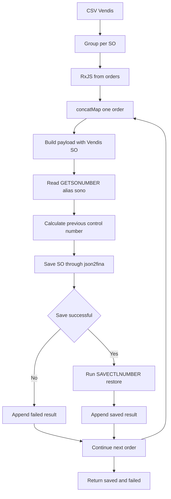

# Task 4462 - Isolasi Running Number SO Vendis dari SO Manual FINA

## Objective

Memastikan setiap SO hasil impor Vendis tetap menggunakan nomor SO dari CSV Vendis tanpa mengubah urutan nomor SO yang akan dipakai user ketika membuat SO manual di FINA. Pemrosesan banyak SO harus konsisten dan benar-benar serial menggunakan RxJS `concatMap`: satu siklus baca nomor kontrol, simpan SO Vendis, dan pulihkan nomor kontrol harus selesai sebelum SO berikutnya dimulai.

Implementasi tidak menggunakan `getFirstValue`. Setiap nilai harus dibaca dari kontrak input atau alias query yang eksplisit agar tidak memilih data berdasarkan perkiraan beberapa kemungkinan nama field.

## Current State

- Task OpenProject `#4462` terdokumentasi di `OP-CAR.md`. Pengujian operasional pada interval 20 menit, 30 menit, dan 1 jam masih menunjukkan nomor Vendis memengaruhi running number SO manual FINA.
- `CAR/cli-script/ftpScript.js` adalah watcher FTP yang membaca CSV Vendis, mengelompokkan baris per nomor SO, membentuk payload `TdmSalesOrder`, lalu mengirimnya melalui `json2fina`.
- `saveSalesOrdersToFina` saat ini memakai `for...of` dan `await`. Untuk setiap order, fungsi membaca `GETSONUMBER.sonumber`, menghitung nomor sebelumnya, menyimpan SO Vendis, lalu menjalankan `SAVECTLNUMBER(..., 3)` untuk memulihkan kontrol nomor.
- Pemulihan saat ini hanya dilakukan setelah respons `json2fina` sukses. Urutan ini perlu dipertahankan dan dinyatakan sebagai pipeline serial yang eksplisit.
- `getFirstValue` dipakai pada konfigurasi API, hasil query nomor SO, hasil query item, dan `userId`. Helper ini mencoba beberapa nama property dan berisiko menyembunyikan ketidaksesuaian kontrak data.
- `CAR/test/ftpScript.test.js` sudah menguji payload Vendis, pembacaan nomor FINA, decrement nomor, `SAVECTLNUMBER`, urutan antar-SO, dan jalur gagal. Baseline saat penyusunan plan: 25 test lulus.
- `CAR/package.json` sudah menyediakan `rxjs` versi `^7.8.1`; tidak diperlukan dependency baru.

## Scope

- In scope: refactor antrean penyimpanan SO Vendis ke RxJS `from(...).pipe(concatMap(...))`, pertahankan boundary Promise untuk caller CLI, hapus `getFirstValue`, gunakan property/alias data yang eksplisit, dan perbarui test untuk membuktikan serialisasi serta isolasi running number.
- In scope: validasi kegagalan di setiap tahap baca nomor, simpan SO, dan restore nomor tanpa menghentikan pemrosesan order berikutnya; hasil tetap dikumpulkan ke `saved` dan `failed`.
- Out of scope: perubahan format nomor SO Vendis, schema `VENDIS_DATA`, interval scheduler, konfigurasi FTP, UI form/list, dan perubahan stored procedure FINA.
- Out of scope: mekanisme locking lintas proses atau transaksi database baru; kebutuhan tersebut harus dievaluasi terpisah bila satu instance watcher masih dapat berkompetisi dengan user FINA di antara operasi `json2fina` dan `SAVECTLNUMBER`.

## Proposed Flow

`concatMap` menjadi jaminan urutan: SO berikutnya tidak masuk ke tahap pembacaan `GETSONUMBER` sebelum restore SO sebelumnya selesai. Pipeline tetap mengembalikan Promise kepada `processCsvFiles` melalui boundary RxJS-to-Promise yang eksplisit. Diagram diperiksa manual karena validator/preview Mermaid extension tidak tersedia di sesi penyusunan plan.

Keputusan kontrak data:

- `queryFirst` tetap menjadi satu-satunya normalizer wrapper respons query; consumer membaca alias query yang dideklarasikan, misalnya `row.sono`, bukan mencoba `SONO`, `SONUMBER`, atau path mentah.
- Query item memakai alias lowercase yang memang dideklarasikan oleh query (`itemno`, `unit1`, `unit2`, `unit3`, `ratio2`, `ratio3`, `taxcodes`, `itemdescription`). Jika alias wajib tidak tersedia, flow menghasilkan error yang jelas, bukan fallback diam-diam.
- `buildApiConfig` mempertahankan precedence konfigurasi yang didukung tetapi menuliskannya per field secara eksplisit; normalisasi alias input dilakukan di boundary konfigurasi, bukan melalui helper variadik generik.
- Payload memakai `apiConfig.userId` yang sudah dinormalisasi oleh `buildApiConfig`; default `"0"` ditetapkan sekali pada boundary tersebut.

## Files

| Action | File | Planned change | Reason |
|---|---|---|---|
| Modify | `CAR/cli-script/ftpScript.js` | Tambahkan operator/factory RxJS yang diperlukan; hapus `getFirstValue`; eksplisitkan kontrak konfigurasi, query nomor SO, item, dan `userId`; ubah `saveSalesOrdersToFina` menjadi pipeline `from(orders)` + `concatMap` yang menyelesaikan read-save-restore per order sebelum lanjut. | Menjamin serialisasi yang konsisten dan menghilangkan fallback berbasis asumsi. |
| Modify | `CAR/test/ftpScript.test.js` | Sesuaikan mock dengan alias canonical; uji pipeline RxJS serial, restore hanya setelah save sukses, kelanjutan setelah error per order, serta ketiadaan ketergantungan pada alias tebakan. | Membuktikan acceptance criteria task dan mencegah regresi kontrak data maupun urutan async. |

Tidak ada file implementasi baru dan tidak ada perubahan dependency atau database.

## Implementation Steps

1. **Tetapkan dependency dan boundary RxJS** (`CAR/cli-script/ftpScript.js`)
   Import hanya primitive RxJS yang dibutuhkan, seperti `from`, `defer`, `concatMap`, operator pengumpulan/error, dan konversi Observable ke Promise. Pertahankan `saveSalesOrdersToFina` sebagai API async/Promise karena `processCsvFiles` dan lifecycle watcher saat ini menunggunya dengan `await`.

2. **Hapus fallback generik `getFirstValue`** (`CAR/cli-script/ftpScript.js`)
   Hapus export fungsi `getFirstValue` dan ganti seluruh call site. Pada `buildApiConfig`, tentukan precedence setiap property secara eksplisit dan normalisasi hasil sekali. Pada payload item, gunakan alias lowercase hasil query secara langsung. Pada `getCurrentSONumber`, baca `row.sono` sesuai key query. Pada payload, gunakan `apiConfig.userId` yang sudah dinormalisasi. Berikan validation error spesifik untuk nilai wajib yang hilang agar mismatch kontrak terlihat saat logging/testing.

3. **Pisahkan satu siklus SO sebagai unit serial** (`CAR/cli-script/ftpScript.js`)
   Susun satu unit kerja order yang melakukan: build payload, log summary, baca nomor kontrol FINA, hitung `restoreNumber`, log pasangan nomor, panggil `json2fina`, validasi `result[0].error`, lalu panggil `saveSOControlNumber`. Hanya setelah restore sukses, bentuk entry `saved`. Pastikan nilai antara disimpan dalam variable bernama dan tidak memakai nested function calls sebagai parameter.

4. **Orkestrasi order dengan `concatMap`** (`CAR/cli-script/ftpScript.js`)
   Ganti `for...of` dengan `from(orders).pipe(concatMap(...))`. Bungkus operasi Promise per order menggunakan `defer`/Observable boundary agar eksekusi baru dimulai saat giliran order tersebut. Tangani error di dalam scope tiap order sehingga entry `failed` dicatat dan stream dapat meneruskan order berikutnya. Kumpulkan hasil akhir lalu kembalikan shape `{ saved, failed }` yang sama kepada caller.

5. **Pertahankan semantics restore dan observability** (`CAR/cli-script/ftpScript.js`)
   Jangan menjalankan `SAVECTLNUMBER` bila `json2fina` gagal. Perlakukan kegagalan restore sebagai kegagalan order dan log tahap yang gagal beserta `file_name`, `order_key`, nomor Vendis, nomor FINA yang dibaca, dan target restore tanpa mencatat kredensial. Pertahankan nomor Vendis di `payload.data.master.sono`.

6. **Perbarui unit test kontrak data dan RxJS** (`CAR/test/ftpScript.test.js`)
   Gunakan hasil query canonical `{ sono: ... }` dan item aliases lowercase. Tambahkan assertion bahwa alias alternatif yang tidak dikontrak tidak dipilih diam-diam. Adaptasi test urutan agar membuktikan pemanggilan order kedua tertahan sampai Promise restore pertama selesai pada pipeline `concatMap`.

7. **Perluas regression test error per order** (`CAR/test/ftpScript.test.js`)
   Verifikasi save gagal tidak memanggil restore; restore gagal masuk `failed`; dan kegagalan satu order tidak menghentikan order berikutnya. Pastikan `processCsvFiles` hanya menandai file ke `VENDIS_DATA` ketika seluruh SO dalam file sukses.

## Validation

- [ ] Jalankan `npm.cmd test -- --runInBand --watchAll=false test/ftpScript.test.js` dari folder `CAR`; seluruh baseline dan test baru lulus.
- [ ] Buktikan melalui mock invocation order bahwa urutan tiap SO adalah `getCurrentSONumber` -> `json2fina` -> `saveSOControlNumber`.
- [ ] Buktikan `concatMap` menahan SO kedua sampai restore SO pertama resolve.
- [ ] Buktikan `payload.data.master.sono` selalu sama dengan nomor dari CSV Vendis.
- [ ] Buktikan hasil query hanya dibaca melalui alias canonical dan tidak ada referensi `getFirstValue` tersisa di `CAR/cli-script/ftpScript.js` maupun test.
- [ ] Buktikan `SAVECTLNUMBER` tidak dipanggil ketika respons `json2fina` mengandung error.
- [ ] Buktikan kegagalan restore tercatat sebagai `failed` dan order berikutnya tetap diproses.
- [ ] Uji integrasi pada database staging: catat next SO manual sebelum sync, impor minimal dua SO Vendis, lalu buka/create SO manual dan pastikan next number tetap sesuai urutan sebelum sync.
- [ ] Ulangi test integrasi dengan dua trigger scheduler yang berdekatan untuk memastikan lock `activeFtpSyncPromise` mencegah overlap dalam satu proses.

## Risks and Mitigations

| Risk | Mitigation |
|---|---|
| User FINA membuat SO manual tepat di antara save Vendis dan restore sehingga terjadi race lintas aplikasi. | Jadikan read-save-restore sesingkat dan serial mungkin; lakukan staging test bersamaan dengan create manual. Jika masih terjadi, eskalasikan sebagai kebutuhan atomic backend transaction/lock karena `concatMap` hanya menjamin urutan dalam proses watcher. |
| Error restore terjadi setelah SO Vendis sudah tersimpan sehingga retry dapat membuat duplikasi. | Catat tahap restore secara eksplisit, pertahankan dedupe berbasis file/Vendis SO yang ada, dan jangan menandai file selesai ketika restore gagal. |
| Penghapusan alias fallback membuka data lama yang tidak sesuai kontrak. | Tetapkan alias pada query/boundary config, tambahkan validasi dengan pesan spesifik, dan uji konfigurasi scheduler aktual sebelum deploy. |
| `catchError` ditempatkan di luar `concatMap` sehingga satu error menghentikan seluruh batch. | Letakkan error handling di Observable per order dan tambahkan test bahwa order berikutnya tetap berjalan. |
| Konversi Observable-Promise mengubah return shape caller. | Pertahankan kontrak `{ saved, failed }` dan regression test `processCsvFiles`/`onInit`. |

## Assumptions / Open Questions

- Diasumsikan alias query Biz-A mengikuti `columns[].key`, sehingga `GETSONUMBER.sonumber` tersedia sebagai `row.sono` dan query item tersedia melalui aliases lowercase yang sudah dideklarasikan.
- Diasumsikan `SAVECTLNUMBER(<nomor sebelumnya>, 3)` adalah kontrak FINA yang benar untuk mengembalikan counter SO setelah `json2fina` menyimpan nomor Vendis.
- `concatMap` mencegah overlap antar-SO dalam satu invocation dan `activeFtpSyncPromise` mencegah overlap watcher dalam satu process. Belum ada bukti bahwa keduanya dapat mengunci konkurensi dari user FINA atau instance CLI lain.
- Perlu dikonfirmasi melalui test staging apakah target restore harus selalu `currentControlNumber - 1`, atau FINA menyediakan API/procedure atomic yang dapat menyimpan SO eksternal tanpa menggerakkan counter. Jika tersedia, mekanisme atomic tersebut lebih kuat daripada read-save-restore di client.
