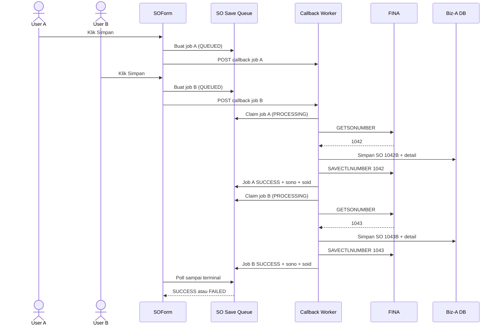
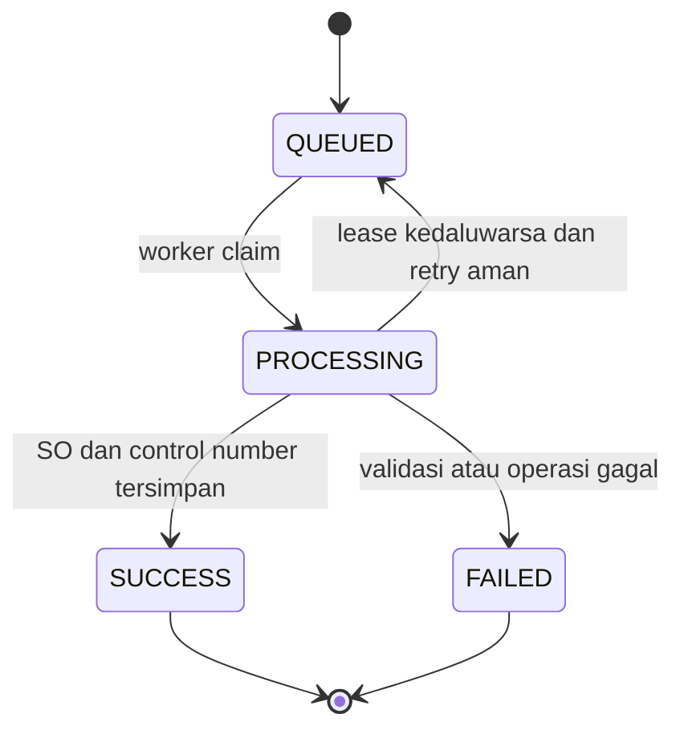

# Callback Queue for SO Running Number

## Objective
Mengubah penyimpanan SO baru menjadi job callback yang diproses berurutan, sehingga pembacaan `GETSONUMBER`, penyimpanan SO, dan pemajuan `SAVECTLNUMBER` tidak dijalankan bersamaan oleh dua browser. Form menampilkan status antrean dan baru menganggap penyimpanan berhasil setelah hasil callback berstatus sukses.

## Current State
- `Endo Medika/SOForm.js` mengambil nomor melalui `resolveSONumberBeforeSave`, menyimpan master/detail, lalu menjalankan `saveSOControlNumber`. Celah waktu antara pembacaan dan pemajuan nomor memungkinkan dua browser memakai nomor yang sama.
- `Endo Medika/migrate/07 SEPTEMBER 2026 unique SO SONO.sql` sudah menyediakan pertahanan terakhir berupa unique constraint `UQ_SO_SONO`.
- Pola callback/antrian lokal terdapat pada `ACB/ppicForm.js`: form membuat status awal, POST ke `/cb`, lalu polling status dengan `interval`, `concatMap`, dan `takeWhile`.
- Worker callback dicontohkan oleh `ACB/cli-script/ppic.js`: endpoint segera mengembalikan acknowledgement, pekerjaan berjalan asynchronous, dan status sukses/gagal ditulis kembali.
- Callback endpoint saja tidak otomatis menghilangkan race condition. Pemroses harus mengklaim job secara atomik dan hanya satu job running-number SO boleh berada pada bagian kritis dalam satu waktu.

## Scope
- In scope: save SO baru dari Biz-A, enqueue callback, polling status, worker FIFO/single-consumer, idempotency, status/error reporting, dan pengujian concurrency.
- In scope: penyimpanan master/detail/attachment serta pemajuan control number dipindahkan ke worker untuk transaksi SO baru.
- Out of scope: mengubah format nomor FINA, mengubah save khusus `source=from-fina`, dan perubahan UI selain status loading/antrean.

## Proposed Flow

Job B boleh sudah masuk antrean saat job A berjalan, tetapi tidak boleh memasuki bagian `GETSONUMBER -> save -> SAVECTLNUMBER` sebelum job A selesai. Nomor preview tetap hanya tampilan; nomor final berasal dari hasil job.

Status yang disarankan:

## Files
| Action | File | Planned change | Reason |
|---|---|---|---|
| Modify | `Endo Medika/SOForm.js` | Ganti save SO baru menjadi create-job, POST callback, polling status, validasi hasil, dan navigasi memakai `soid`/`sono` hasil worker | Browser tidak lagi mengambil dan memakai nomor final sendiri |
| Create | `Endo Medika/cli-script/so_save_queue.js` | Tambahkan worker callback untuk claim FIFO, idempotency, `GETSONUMBER`, save master/detail/attachment, `SAVECTLNUMBER`, dan update status | Menyatukan bagian kritis di pemroses terkontrol |
| Create | `Endo Medika/migrate/10 SEPTEMBER 2026 add SO save queue.sql` | Tambahkan tabel antrean/status, generator, trigger ID, index status/waktu, serta mekanisme atomic claim/lease | Menyediakan antrean persisten dan pemilihan satu job secara aman |
| Modify | `Endo Medika/test/runningNumberForm.test.js` | Ubah ekspektasi save baru ke enqueue/polling dan pastikan preview tidak menjadi nomor final | Melindungi kontrak frontend baru |
| Create | `Endo Medika/test/SOFormCallbackQueue.test.js` | Uji status queued/processing/success/failed, timeout, duplicate click, dan response normalization | Menguji orkestrasi callback pada form |
| Create | `Endo Medika/test/soSaveQueueCli.test.js` | Uji FIFO, atomic claim, dua job simultan menghasilkan nomor berbeda, idempotency, retry, serta failure status | Membuktikan race condition ditutup pada worker |

## Implementation Steps
1. **Buat kontrak job antrean** (`Endo Medika/migrate/10 SEPTEMBER 2026 add SO save queue.sql`)
   Buat tabel misalnya `SO_SAVE_QUEUE` dengan `ID`, `REQUEST_ID`, `STATUSDATA`, `PAYLOAD`, `SO_ID`, `SO_NO`, `ERROR_MESSAGE`, `RETRY_COUNT`, `CREATED_AT`, `STARTED_AT`, `FINISHED_AT`, dan `LEASE_UNTIL`. Beri unique constraint pada `REQUEST_ID` untuk idempotency serta index `(STATUSDATA, CREATED_AT)` untuk FIFO. Definisikan prosedur atomic claim agar dua callback tidak dapat mengklaim job yang sama atau menjalankan bagian nomor SO bersamaan.

2. **Enqueue dari form** (`Endo Medika/SOForm.js`)
   Setelah merge `this.model` dan `this.form.value`, validasi dan buat `request_id` stabil untuk satu klik Save. Simpan snapshot payload job dengan status `QUEUED`, lalu POST `{ job_id, request_id, dbIndexFina, userid }` ke callback. Jangan panggil `resolveSONumberBeforeSave` atau `saveSOControlNumber` dari browser untuk SO baru.

3. **Cegah duplikasi dari satu browser** (`Endo Medika/SOForm.js`)
   Kunci aksi Save selama request aktif. Jika acknowledgement callback hilang, gunakan `request_id` yang sama ketika mengecek atau mengirim ulang, sehingga retry tidak membuat SO kedua.

4. **Proses job dalam worker** (`Endo Medika/cli-script/so_save_queue.js`)
   Claim satu job tertua secara atomik. Setelah status `PROCESSING`, ambil nomor FINA terbaru, bentuk suffix Biz-A `B`, simpan master dan detail, simpan attachment bila ada, lalu panggil `SAVECTLNUMBER` tanpa suffix. Simpan `SO_ID` dan `SO_NO` ke job dan ubah status menjadi `SUCCESS`; pada error simpan pesan dan status `FAILED`.

5. **Pertahankan konsistensi lintas database** (`Endo Medika/cli-script/so_save_queue.js`)
   Karena Biz-A dan FINA kemungkinan bukan satu transaksi database, worker harus idempotent per tahap. Sebelum retry, cek apakah `request_id` sudah menghasilkan `SO_ID`; jangan insert ulang. Unique constraint `UQ_SO_SONO` tetap aktif sebagai pertahanan terakhir. Jika SO sudah tersimpan tetapi `SAVECTLNUMBER` gagal, tandai kegagalan parsial yang dapat dilanjutkan dari tahap control-number, bukan mengulang insert.

6. **Polling hasil job** (`Endo Medika/SOForm.js`)
   Query status segera setelah callback acknowledgement, lalu setiap sekitar 2–5 detik memakai `concatMap` dan `takeWhile(..., true)`. `SUCCESS` menampilkan nomor final dan navigasi; `FAILED` menampilkan `ERROR_MESSAGE`; timeout menghentikan loading tetapi mempertahankan `job_id` agar status dapat dicek kembali.

7. **Uji concurrency dan recovery** (`Endo Medika/test/runningNumberForm.test.js`, `Endo Medika/test/SOFormCallbackQueue.test.js`, `Endo Medika/test/soSaveQueueCli.test.js`)
   Simulasikan dua job dengan nomor awal sama dan pastikan hasil akhirnya berurutan serta berbeda. Uji callback acknowledgement terlambat, polling terminal, retry dengan request yang sama, worker crash setelah insert, dan penolakan unique constraint.

## Validation
- [ ] Dua browser mengirim SO hampir bersamaan; job diproses FIFO dan menghasilkan dua `SONO` berbeda.
- [ ] Hanya satu job SO berstatus `PROCESSING` pada bagian kritis running number untuk satu database FINA.
- [ ] Klik Save berulang dari browser yang sama menghasilkan satu `REQUEST_ID` dan satu SO.
- [ ] Preview `_____B` tidak pernah masuk ke payload SO final.
- [ ] `SUCCESS` hanya diterbitkan setelah master, semua detail, attachment yang diwajibkan, dan `SAVECTLNUMBER` berhasil.
- [ ] Kegagalan menyimpan detail atau control number menghasilkan `FAILED` dengan pesan yang bisa ditindaklanjuti.
- [ ] Retry setelah acknowledgement hilang tidak membuat SO kedua.
- [ ] Save edit dan jalur `from-fina` tetap berfungsi sesuai perilaku sebelumnya.
- [ ] Unique constraint `UQ_SO_SONO` tetap aktif dan diuji sebagai pertahanan terakhir.

## Risks and Mitigations
| Risk | Mitigation |
|---|---|
| Endpoint callback menjalankan beberapa invocation bersamaan | Jangan mengandalkan urutan HTTP; gunakan atomic claim/semaphore database dan satu bagian kritis per `finaDbIndex` |
| Worker mati setelah SO tersimpan tetapi sebelum control number maju | Simpan checkpoint tahap dan lanjutkan hanya dari tahap yang belum selesai berdasarkan `REQUEST_ID`/`SO_ID` |
| Payload antrean terlalu besar karena attachment base64 | Simpan attachment terpisah atau gunakan referensi staging; tetapkan batas ukuran payload |
| Polling berjalan tanpa batas | Tambahkan timeout frontend dan status lease untuk recovery worker |
| Urutan FIFO global memperlambat cabang/database lain | Kunci antrean per `finaDbIndex` atau lingkup control-number yang memang berbagi sequence |
| Callback diterima dua kali | Unique `REQUEST_ID` dan worker idempotent mengubah pengiriman ulang menjadi pembacaan job yang sama |

## Assumptions / Open Questions
- Diasumsikan callback Biz-A dapat menjalankan CLI script baru dan membaca/menulis database Biz-A serta FINA seperti pola `ACB/cli-script/ppic.js`.
- Mekanisme atomic claim Firebird perlu disesuaikan dengan versi database dan kemampuan endpoint yang tersedia; HTTP callback sendiri bukan jaminan single-consumer.
- Perlu dipastikan apakah attachment layak disimpan di payload antrean atau harus distaging terpisah.
- Mermaid diperiksa manual karena validator/preview extension tidak tersedia sebagai tool callable pada sesi ini.
