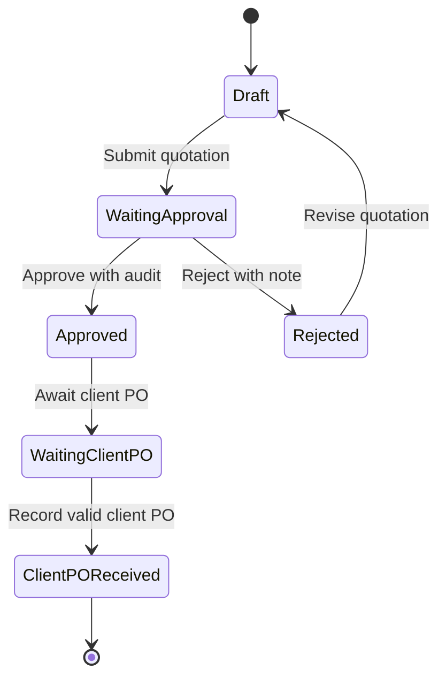
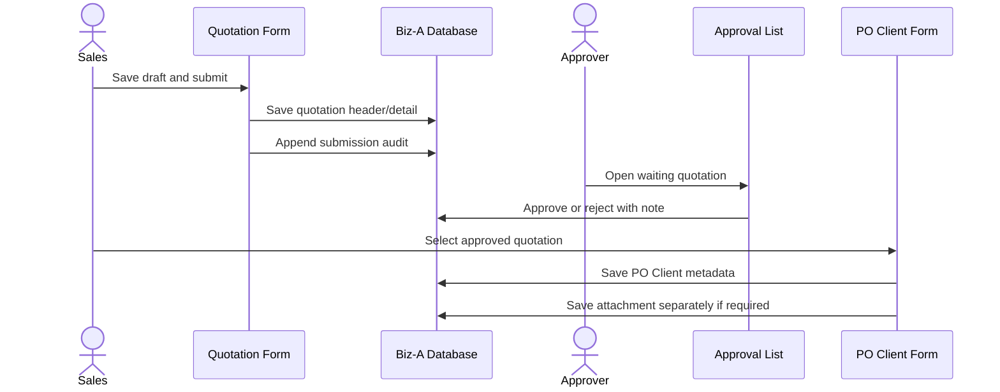

# Task #5518 - Requirement Quotation, Approval, dan PO Client

## Objective

Menyediakan alur penjualan Missi Idea dari pembuatan quotation, pengajuan dan keputusan approval, sampai pencatatan PO yang diterima dari client. Pengguna harus dapat melihat posisi dokumen, pihak yang melakukan tindakan, dan hubungan quotation dengan PO Client tanpa dapat melewati urutan proses atau mengubah dokumen yang sudah final.

Analisis ini bersifat **draft terarah**. Deskripsi OpenProject hanya memuat tautan Google Docs dan video UI yang membutuhkan login, sedangkan source folder `Missi Idea` belum ada di checkout repo. Nama field, status final, privilege, serta kardinalitas PO Client wajib dikonfirmasi dari dokumen tersebut sebelum implementasi.

## Current State

- `OP-Missi Idea.md` hanya menyebut task **Requirement Quotation - Approval - PO Client**, status Scheduled, serta tautan requirement dan UI Desktop. Tidak ada acceptance criteria tertulis di task lokal.
- Google Docs requirement mengembalikan HTTP 401 dan video Drive mengarah ke login. Browser terautentikasi juga tidak tersedia pada sesi analisis ini.
- Tidak terdapat folder, `menu.json`, source, migration, atau unit test untuk project `Missi Idea` di repository saat ini. Task ini karena itu terlihat sebagai module baru atau source project yang belum disinkronkan.
- Referensi lokal paling dekat adalah alur LANTERA:
  - `LANTERA/quotationForm.js` dan `LANTERA/quotationList.js` untuk quotation header/detail dan status `On Progress`/`Deal`.
  - `LANTERA/approvalList.js` untuk approve/reject quotation dan pencatatan alasan.
  - `LANTERA/purchaseOrderForm.js` dan `LANTERA/purchaseOrderList.js` untuk form/list PO, status Draft/Approved/Rejected, privilege approval, detail rows, running number, dan print.
  - `LANTERA/sql/sql_purchase_order.txt` untuk pola tabel Firebird header/detail beserta generator dan trigger.
- `LANTERA/purchaseOrder*` adalah PO keluar ke supplier. Untuk task #5518, istilah **PO Client** lebih mungkin merupakan PO masuk dari client sebagai tindak lanjut quotation; tabel dan perilakunya tidak boleh disalin mentah sebelum arah dokumen ini dikonfirmasi.
- Aturan repo yang relevan: lifecycle form/list Firlan, approval berbasis privilege bukan nama group, primary key hanya di model/payload, detail-grid sebagai source data yang eksplisit, dan file attachment disimpan melalui `updateImg` terpisah dari payload JSON.

## Scope

- In scope:
  - Quotation header dan detail item/jasa.
  - Status dan aksi submit, approve, reject, revise/resubmit.
  - Daftar approval yang hanya menampilkan dokumen yang dapat diproses user.
  - Pencatatan PO Client yang ditautkan ke quotation approved.
  - Audit minimum: actor, timestamp, status asal/tujuan, dan catatan keputusan.
  - Hak akses berbasis custom privilege.
  - UI responsif mengikuti mockup Desktop dan, setelah tersedia, keputusan untuk Mobile.
  - Migration Firebird dan unit/regression test untuk state transition, authorization, save/load, serta attachment bila PO Client memang berupa dokumen upload.
- Out of scope:
  - PO pembelian ke supplier, inventory, delivery, invoice, dan accounting posting kecuali dinyatakan di requirement asli.
  - Print quotation/PO, email/notifikasi, integrasi FINA, dan multi-level approval tambahan sampai disebut eksplisit di requirement.
  - Implementasi source pada fase analisis ini.

## Requirement Breakdown

| Area | Kebutuhan minimum yang dapat diturunkan | Hal yang perlu dikonfirmasi |
|---|---|---|
| Quotation | Create/edit draft, header client/project, detail item/jasa, subtotal/discount/tax/total, terms, notes | Daftar field, rumus, lookup, currency, numbering, dan print |
| Submission | Draft dikunci saat diajukan dan masuk antrean approval | Siapa yang boleh submit/cancel/reopen |
| Approval | Approve/reject dengan catatan dan audit actor/time | Satu atau multi-level, approver per nominal/divisi, status exact |
| Revision | Rejected dikembalikan ke pembuat untuk revisi dan resubmit | Apakah nomor/revisi berubah dan histori versi dipertahankan |
| PO Client | Hanya quotation approved yang dapat dipilih; simpan identitas PO dan relasinya | Satu atau banyak PO per quotation, mandatory attachment, nilai PO harus sama/tidak melebihi quotation |
| Authorization | Aksi tampil/aktif berdasarkan privilege dan ownership | Nama privilege serta data scoping per user/department |
| Responsive UI | Layout field/detail/action tidak keluar viewport | Link UI Mobile kosong; apakah mobile termasuk acceptance criteria |

## Proposed Flow

Status pada diagram adalah vocabulary usulan untuk menjaga alur eksplisit. Jika database hanya membutuhkan satu status quotation dan keberadaan row PO Client menjadi indikator tahap akhir, `WaitingClientPO` dapat diturunkan sebagai display state, bukan disimpan sebagai status tambahan.

Keputusan utama adalah menjadikan quotation header/detail, approval history, dan PO Client sebagai data terpisah tetapi berelasi. Setiap transition divalidasi kembali terhadap status terbaru dari database untuk mencegah double action atau stale UI.

## Files

Daftar berikut adalah struktur **yang diusulkan** karena folder target belum tersedia. Konfirmasi nama folder project dan apakah source sebenarnya berada di repo/branch lain sebelum membuat file.

| Action | File | Planned change | Reason |
|---|---|---|---|
| Create | `Missi Idea/menu.json` | Daftarkan menu Quotation, Quotation Approval, dan PO Client | Entry point ketiga tahap workflow |
| Create | `Missi Idea/quotationForm.js` | Form header/detail, lifecycle, validation, save/load, submit/resubmit, readonly by status | Source of truth quotation |
| Create | `Missi Idea/quotationList.js` | List quotation milik/tercakup user, action create/edit/view/submit | Operasional Sales |
| Create | `Missi Idea/quotationApprovalList.js` | Queue approval, view, approve/reject, note dialog, privilege checks | Keputusan approval terpisah dari edit form |
| Create | `Missi Idea/clientPoForm.js` | Pilih quotation approved, simpan metadata PO Client, validasi duplikasi/nilai, upload attachment bila wajib | Tahap penerimaan PO Client |
| Create | `Missi Idea/clientPoList.js` | List PO Client dan navigasi view/edit sesuai status/privilege | Monitoring PO yang sudah diterima |
| Create | `Missi Idea/lib_qry.js` | Query builders untuk quotation, detail, approval history, eligible quotation, dan PO Client tanpa join path terlalu dalam | Memisahkan data access dari form/list |
| Create | `Missi Idea/lib_authorization.js` | Normalisasi privilege dan data scoping workflow | Hindari authorization berdasarkan nama group |
| Create | `Missi Idea/migrate/001_create_quotation_approval_client_po.sql` | Tabel header/detail quotation, approval history, PO Client, optional attachment column, FK/index/generator/BI trigger | Kontrak persistence Firebird |
| Create | `Missi Idea/tests/testUtils.js` | Loader/binder test sesuai pola module Biz-A | Test harness project baru |
| Create | `Missi Idea/tests/quotationForm.test.js` | Test field contract, calculation, save/load, validation, submit/resubmit, readonly status | Regression form utama |
| Create | `Missi Idea/tests/quotationList.test.js` | Test filter ownership/status dan action navigation | Regression list Sales |
| Create | `Missi Idea/tests/quotationApprovalList.test.js` | Test privilege, approve/reject note, stale status, double action | Regression approval |
| Create | `Missi Idea/tests/clientPoForm.test.js` | Test eligible quotation, relational payload, duplicate/value rules, attachment flow | Regression PO Client |
| Create | `Missi Idea/tests/clientPoList.test.js` | Test columns, status/action, dan view/edit navigation | Regression list PO Client |
| Create | `Missi Idea/tests/lib_qry.test.js` | Test query filters, keys, short relation paths, dan exclusion status | Contract data access |
| Create | `Missi Idea/tests/lib_authorization.test.js` | Test privilege mapping dan denial defaults | Security regression |

Tidak ada file existing yang aman untuk dimodifikasi sampai source project Missi Idea tersedia atau lokasi target dikonfirmasi.

## Implementation Steps

1. **Konfirmasi kontrak requirement dan target project** (`OP-Missi Idea.md`)
   Dapatkan isi Google Docs/video, pastikan folder/source target, field matrix, role/privilege, state exact, numbering, responsive scope, dan definisi PO Client. Hentikan desain database bila salah satu keputusan kardinalitas atau ownership masih belum jelas.

2. **Tetapkan state machine dan authorization contract** (`Missi Idea/lib_authorization.js`)
   Definisikan transition yang sah dan privilege seperti create/edit/submit quotation, approve/reject quotation, dan create/edit/view PO Client. List hanya membentuk visibility/action dari privilege; handler wajib memvalidasi status database terbaru sebelum mutation.

3. **Buat schema dan migration** (`Missi Idea/migrate/001_create_quotation_approval_client_po.sql`)
   Gunakan `ID` sebagai PK, `<TABLE>_GEN`, `<TABLE>_BI`, FK dari detail dan approval history ke quotation, serta FK PO Client ke quotation. Tambahkan unique constraint sesuai hasil konfirmasi: nomor PO Client global/per-client dan one-to-one atau one-to-many quotation-to-PO. Index-kan FK, status, quotation number, client PO number, dan queue approval.

4. **Bangun query layer** (`Missi Idea/lib_qry.js`)
   Sediakan query header/detail terpisah, approval queue/scoping, history, quotation approved yang belum/masih dapat menerima PO, dan PO Client. Hindari BLOB attachment di query master; load attachment terpisah bila dibutuhkan.

5. **Bangun quotation form/list** (`Missi Idea/quotationForm.js`, `Missi Idea/quotationList.js`)
   Ikuti lifecycle Firlan: setup + `setDbIndex` di `beforeLoadData`, new/edit load di `onInit`, reference data di `preparingData`, reactive calculation di `listener`, lalu save flow RxJS linear. Merge `{ ...this.model, ...this.form.value }` sebelum validation/payload. Detail-grid tetap menjadi array model yang eksplisit dan disinkronkan dengan `assignData` setelah add/delete.

6. **Bangun approval queue dan transition** (`Missi Idea/quotationApprovalList.js`)
   Load hanya waiting rows yang sesuai scoping. Dialog approve/reject harus menghasilkan note sesuai mandatory rule. Mutation menyimpan status header dan row audit secara konsisten; success hanya ditampilkan setelah semua response tervalidasi. Rejected dapat dibuka kembali untuk revisi sesuai state machine final.

7. **Bangun PO Client form/list** (`Missi Idea/clientPoForm.js`, `Missi Idea/clientPoList.js`)
   Lookup quotation hanya mengambil approved rows yang eligible. Autofill data client/quotation yang bersifat snapshot/read-only, simpan foreign key quotation dan metadata PO Client. Jika upload diwajibkan, master disimpan lebih dulu, kemudian file melalui `updateImg`; file/BLOB tidak masuk `sendModel` JSON.

8. **Daftarkan menu dan mode navigation** (`Missi Idea/menu.json`)
   Gunakan route form/list standar. `view` selalu readonly; dokumen submitted/approved tidak dapat diedit melalui perubahan query params. Mobile layout harus mengikuti hasil review UI Mobile, bukan sekadar mengecilkan desktop grid.

9. **Tambahkan contract dan regression tests** (`Missi Idea/tests/*.test.js`)
   Uji happy path serta denial path setiap transition, role tanpa privilege, rejected-resubmit, duplicate approval click, PO untuk quotation non-approved, duplicate PO number, one/many PO constraint, mismatch total, attachment reload, dan model/form synchronization.

## Acceptance Criteria Draft

- [ ] Sales dapat membuat, menyimpan draft, mengedit, dan submit quotation valid.
- [ ] Quotation submitted tidak bisa diedit sampai ditolak/dibuka kembali sesuai rule.
- [ ] Hanya user dengan privilege yang sesuai dapat approve/reject; setiap aksi mencatat actor, waktu, dan note.
- [ ] Reject mengembalikan quotation ke jalur revisi tanpa menghapus histori keputusan.
- [ ] PO Client hanya dapat dibuat untuk quotation approved dan relasinya tersimpan eksplisit.
- [ ] Sistem menolak duplicate PO number dan pelanggaran kardinalitas/value rule yang telah disepakati.
- [ ] View mode tetap readonly walau query params dimanipulasi.
- [ ] List Sales, Approval, dan PO Client menerapkan data scoping serta action visibility yang benar.
- [ ] Bila attachment diwajibkan, file dapat save-load ulang tanpa masuk payload JSON master.
- [ ] Layout Desktop sesuai video dan Mobile sesuai mockup/keputusan final tanpa detail/action keluar viewport.

## Validation

- [ ] Jalankan seluruh unit test `Missi Idea/tests` secara isolated.
- [ ] Uji transition Draft → Waiting Approval → Approved → PO Client Received.
- [ ] Uji transition Waiting Approval → Rejected → Revised → Resubmitted dengan audit utuh.
- [ ] Uji concurrent/stale action: dua approver tidak dapat memproses row yang sama dua kali.
- [ ] Uji authorization untuk user tanpa privilege serta ownership/data scope.
- [ ] Uji perhitungan quotation dan PO Client terhadap contoh angka dari requirement asli.
- [ ] Uji create/edit/view pada desktop dan viewport mobile yang ditentukan.
- [ ] Uji migration pada database staging termasuk PK/generator/trigger/FK/unique/index.
- [ ] Uji attachment PDF/image save, edit/reopen, dan replace bila termasuk requirement.
- [ ] Regression check: modul referensi LANTERA tidak dimodifikasi dan test suite existing tetap lulus.

## Risks and Mitigations

| Risk | Mitigation |
|---|---|
| Salah menafsirkan PO Client sebagai PO supplier | Konfirmasi arah dokumen, owner, dan business event sebelum schema dibuat |
| Requirement/private UI belum terbaca | Minta export PDF/DOCX/video atau akses browser terautentikasi; lakukan sign-off field/status matrix |
| Source Missi Idea tidak ada di checkout | Konfirmasi repo/branch/folder dan database config sebelum scaffold |
| Multi-level approval ternyata diperlukan | Simpan approval history sebagai rows; jangan hard-code satu kolom approver per role |
| Race/double approval | Reload status terbaru sebelum mutation dan gunakan transition guard/transaction backend bila tersedia |
| Satu quotation dapat memiliki beberapa PO parsial | Tetapkan cardinality dan balance/value rule; gunakan child rows dan aggregate, bukan scalar header |
| BLOB merusak response JSON | Simpan/load attachment melalui API terpisah dan exclude dari broad query |
| Action hanya disembunyikan di UI | Validasi privilege dan status di handler sebelum setiap mutation |
| Desktop design tidak cocok mobile | Tunggu keputusan UI Mobile dan uji breakpoint nyata untuk field, grid, serta action |

## Assumptions / Open Questions

- Apakah folder target benar `Missi Idea`, atau source berada di repository/branch lain?
- Mohon export/share isi Google Docs dan video UI karena keduanya membutuhkan login pada sesi ini.
- Apakah PO Client adalah dokumen masuk dari client setelah quotation approved?
- Apakah satu quotation boleh memiliki lebih dari satu PO Client (partial PO), dan apakah satu PO boleh merujuk lebih dari satu quotation?
- Apa daftar field wajib, lookup source, rumus subtotal/discount/tax/total, currency, serta format running number quotation?
- Approval satu level atau bertingkat? Siapa approver, bagaimana threshold/routing, dan apa nama custom privilege exact?
- Apakah note wajib untuk approve, reject, atau keduanya?
- Apakah reject mengubah dokumen yang sama, membuat revision row, atau membuat quotation baru dengan reference ke versi lama?
- Apakah approved quotation masih bisa cancel/reopen? Jika ya, privilege dan audit rule apa yang berlaku?
- Field PO Client apa saja: nomor, tanggal, nilai, client/project, PIC, due date, attachment, dan remarks?
- Apakah nilai PO Client harus sama dengan quotation, boleh lebih kecil untuk partial order, atau dapat berbeda dengan tolerance/approval tambahan?
- Apakah upload PO wajib, tipe/ukuran file apa yang diterima, dan apakah version/replace/delete attachment diperbolehkan?
- Apakah print, PDF, email/notifikasi, atau integrasi FINA termasuk scope?
- Link UI Mobile kosong. Apakah mobile tetap wajib pada acceptance criteria task #5518?

Mermaid diperiksa manual: kedua blok menggunakan keyword valid (`stateDiagram-v2` dan `sequenceDiagram`), pasangan participant/actor lengkap, serta seluruh arrow dan label seimbang. Tool validator/preview Mermaid tidak tersedia pada sesi ini.
