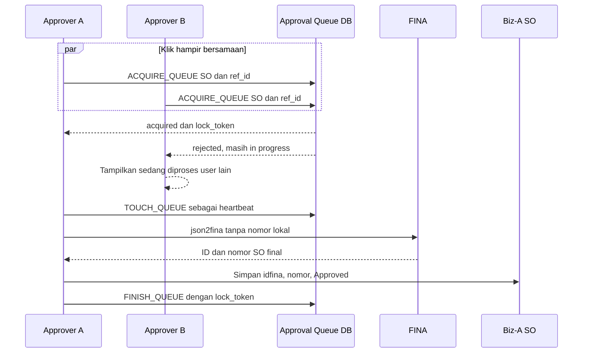

# Task 5570 - Queue Approval SO dan Running Number FINA

## Objective
Mencegah satu SO Biz-A dibuat lebih dari sekali di FINA ketika beberapa user menekan Approve bersamaan. Approval memakai queue database dengan lease satu menit: hanya satu request yang memperoleh queue `in progress`; request lain berhenti sebelum `json2fina`. Queue yang tidak diperbarui lebih dari satu menit dianggap gagal dan diubah menjadi `terminated`. Nomor SO tetap kosong selama draft dan baru disimpan ke Biz-A setelah FINA berhasil membuat SO dan mengembalikan nomor final.

## Current State
- `Endo Medika/SOForm.js` sudah menyimpan draft tanpa nomor SO. `JSONBIZASO` hanya mengisi `sono` ketika `idfina` tersedia.
- `onClickApprove` saat ini langsung memanggil `json2fina`, membaca nomor melalui `getSOFina`, lalu menyimpan `idfina`, nomor, dan status Approved ke Biz-A.
- Tidak ada koordinasi lintas browser sebelum side effect FINA. Dua approver dapat membuat dua SO FINA dari satu SO Biz-A.
- Check status lalu update status `approving` dalam dua statement tetap mempunyai race window. Karena itu lock tidak boleh dibangun sebagai read-then-write dari form.
- Constraint `UQ_SO_SONO` hanya melindungi database Biz-A setelah FINA membuat dokumen; constraint tersebut tidak mencegah duplikasi di FINA.
- Queue harus diperoleh oleh satu stored procedure atomik. Procedure `getQueue` yang hanya membersihkan dan membaca queue berguna untuk observasi, tetapi tidak cukup menjadi mutex apabila insert dilakukan terpisah oleh form.

## Scope
- In scope: tabel queue approval, stored procedure untuk membaca/menormalkan queue, acquire atomik, heartbeat lease, finish/terminate, integrasi approval SO, notifikasi request yang kalah, dan regression test concurrency.
- Out of scope: membersihkan SO0045/SO0046 yang sudah telanjur terbentuk, mengubah generator FINA, background worker, dan perubahan flow DO/SI.

## Proposed Flow

`GET_QUEUE(module, ref_id)` terlebih dahulu menandai lease `in progress` yang `updated_at`-nya lebih lama dari satu menit sebagai `terminated`, lalu mengembalikan queue aktif. Namun jalur approval memakai `ACQUIRE_QUEUE` yang menjalankan expire-check dan claim dalam satu transaksi database. Queue memakai satu row per pasangan `(module, ref_id)` dan `lock_token` sebagai fencing token agar proses lama yang hidup kembali tidak dapat menyentuh atau menyelesaikan lease milik proses baru.

## Files
| Action | File | Planned change | Reason |
|---|---|---|---|
| Create | `Endo Medika/migrate/17 SEPTEMBER 2026 task 5570 approval queue.sql` | Buat tabel approval queue, unique/primary key `(module, ref_id)`, field status/timestamp, field internal `lock_token`, serta procedure `GET_QUEUE`, `ACQUIRE_QUEUE`, `TOUCH_QUEUE`, dan `FINISH_QUEUE`. | Mutual exclusion harus ditegakkan secara atomik oleh database, dengan expiry dan fencing untuk lease lama. |
| Modify | `Endo Medika/lib_queryRaw.js` | Tambahkan wrapper procedure queue, normalisasi hasil acquire/get, dan parameter escaping/validation. Semua call menggunakan dbIndex Biz-A. | Query dan procedure access tetap terpisah dari orkestrasi form. |
| Modify | `Endo Medika/SOForm.js` | Daftarkan `lib_queryRaw`; acquire queue ketika Approve diklik; hentikan loser sebelum `json2fina`; jalankan heartbeat; finish queue saat sukses; terminate/release aman saat gagal; pertahankan lock bila FINA sudah terbentuk tetapi sinkronisasi Biz-A gagal. | Menutup race sebelum side effect eksternal dan menjaga nomor final tetap berasal dari FINA. |
| Modify | `Endo Medika/test/lib_queryRaw.test.js` | Uji wrapper `GET_QUEUE`, acquire, touch, finish, parameter, dbIndex, dan parsing hasil menang/kalah/expired. | Memastikan kontrak procedure dipakai dengan benar oleh client. |
| Modify | `Endo Medika/test/SOFormCreditLimit.test.js` | Tambahkan skenario dua approval, queue ditolak, heartbeat, expiry, failure sebelum/sesudah ID FINA, dan success path nomor final. | Membuktikan hanya pemilik lease yang dapat memanggil FINA dan menyelesaikan approval. |

Tidak ada perubahan yang direncanakan pada list SO atau generator/control number FINA.

## Implementation Steps
1. **Buat schema queue dan constraint identitas** (`Endo Medika/migrate/17 SEPTEMBER 2026 task 5570 approval queue.sql`)
   Buat tabel dengan `module`, `ref_id`, `status`, `created_at`, `updated_at`, dan `lock_token`. Gunakan `(module, ref_id)` sebagai primary/unique key sehingga database hanya mempunyai satu state queue terkini untuk satu dokumen. Status yang didukung minimal `in progress`, `finish`, dan `terminated`.
2. **Buat `GET_QUEUE(module, ref_id)`** (migration yang sama)
   Dalam procedure, ubah queue `in progress` dengan `updated_at` lebih lama dari satu menit menjadi `terminated`, kemudian kembalikan row yang masih `in progress`. Procedure ini dipakai untuk pengecekan/diagnostik dan menggunakan waktu database, bukan jam browser.
3. **Buat acquire atomik** (migration yang sama)
   Tambahkan `ACQUIRE_QUEUE(module, ref_id, lock_token)` yang melakukan expire-check dan claim dalam satu transaksi. Bila row aktif masih ada, return `acquired = 0`; bila row tidak ada atau sudah `finish/terminated`, insert/update menjadi `in progress`, reset timestamps, simpan token baru, lalu return `acquired = 1`. Tangani konflik unique/concurrent update sebagai claim kalah, bukan error yang melanjutkan approval.
4. **Buat heartbeat dan finalisasi berpagar token** (migration yang sama)
   `TOUCH_QUEUE` hanya memperbarui `updated_at` jika module, ref_id, status `in progress`, dan token cocok. `FINISH_QUEUE` juga mensyaratkan token cocok. Sediakan terminasi/release bersyarat untuk kegagalan sebelum dokumen FINA terbentuk. Token mencegah proses lama mengubah lease baru setelah lease lamanya kedaluwarsa.
5. **Expose procedure melalui query library** (`Endo Medika/lib_queryRaw.js`)
   Tambahkan fungsi bernama bisnis seperti `getApprovalQueue`, `acquireApprovalQueue`, `touchApprovalQueue`, dan `finishApprovalQueue`. Validasi `module/ref_id/token`, gunakan dbIndex Biz-A, dan kembalikan bentuk data sederhana untuk form.
6. **Integrasikan lease ke approval** (`Endo Medika/SOForm.js`)
   Setelah validation dan konfirmasi credit limit, buat token request lalu acquire queue sebelum membangun/mengirim payload FINA. Jika tidak acquired, tampilkan pesan “SO sedang diproses atau telah diapprove oleh user lain” dan jangan memanggil `json2fina` maupun `saveSOToBiza`.
7. **Jaga lease selama approval berjalan** (`Endo Medika/SOForm.js`)
   Mulai heartbeat lebih pendek dari satu menit, misalnya setiap 20 detik, dan hentikan timer pada seluruh terminal path. Lakukan touch juga di batas tahap penting. Jika heartbeat kehilangan ownership, hentikan proses sebelum side effect berikutnya bila masih aman dilakukan.
8. **Finalisasi berdasarkan titik side effect** (`Endo Medika/SOForm.js`)
   Jika gagal sebelum FINA mengembalikan ID, terminate queue dengan token agar bisa dicoba ulang. Setelah FINA mengembalikan ID, simpan link master Biz-A (`idfina`, nomor final, Approved) sebelum detail/attachment. Jika sinkronisasi setelah FINA gagal, jangan membuka queue otomatis; tandai/pertahankan state yang mencegah approve ulang dan tampilkan pesan rekonsiliasi. Setelah seluruh proses sukses, ubah queue menjadi `finish`.
9. **Tambahkan regression tests** (`Endo Medika/test/lib_queryRaw.test.js`, `Endo Medika/test/SOFormCreditLimit.test.js`)
   Verifikasi dua pemanggilan paralel untuk key yang sama menghasilkan tepat satu winner secara kontrak, loser tidak menyentuh FINA, stale queue dapat direbut dengan token baru, token lama tidak bisa touch/finish, serta nomor hasil FINA disimpan tepat satu kali.

## Validation
- [ ] Jalankan `npx jest test/lib_queryRaw.test.js test/SOFormCreditLimit.test.js --runInBand` dari folder `Endo Medika`.
- [ ] Jalankan seluruh Jest suite Endo Medika.
- [ ] Uji dua browser menekan Approve pada SO yang sama; pastikan hanya satu call `json2fina` dan satu SO FINA.
- [ ] Pastikan loser menerima notifikasi tanpa melakukan save Biz-A/FINA.
- [ ] Buat queue `in progress` dengan `updated_at` lebih lama dari satu menit; panggil `GET_QUEUE` dan pastikan row menjadi `terminated` serta tidak dikembalikan sebagai aktif.
- [ ] Pastikan heartbeat mempertahankan queue untuk approval yang valid lebih dari satu menit.
- [ ] Pastikan token lama tidak dapat touch, terminate, atau finish setelah lease diambil proses baru.
- [ ] Simulasikan kegagalan sebelum ID FINA dan pastikan approval dapat dicoba ulang.
- [ ] Simulasikan kegagalan setelah ID FINA dan pastikan approval kedua tetap diblokir untuk mencegah dokumen FINA ganda.
- [ ] Verifikasi draft tetap memiliki `SONO = null`; approval sukses menyimpan nomor final FINA bersuffix Biz-A.

## Risks and Mitigations
| Risk | Mitigation |
|---|---|
| Form melakukan `GET_QUEUE` lalu insert terpisah sehingga race tetap ada. | Approval wajib memakai `ACQUIRE_QUEUE` atomik; `GET_QUEUE` hanya untuk membaca/diagnostik. |
| Proses valid berjalan lebih dari satu menit dan dianggap gagal. | Heartbeat memperbarui `updated_at` setiap 20 detik menggunakan waktu database. |
| Proses lama hidup kembali setelah lease direbut. | Semua touch/finalize mensyaratkan `lock_token` yang dikembalikan saat acquire. |
| FINA berhasil tetapi Biz-A gagal menyimpan hasil. | Jangan release queue; blokir approve ulang dan arahkan ke rekonsiliasi berdasarkan ID FINA yang sudah diterima. |
| Browser ditutup sebelum heartbeat berikutnya. | Lease otomatis menjadi `terminated` setelah lebih dari satu menit, tetapi retry hanya aman apabila belum ada ID FINA; failure setelah side effect FINA tetap memerlukan state yang tidak membuka duplicate approval. |
| Migration belum diterapkan ketika kode baru aktif. | Wrapper procedure harus menghasilkan error konfigurasi yang jelas dan approval tidak boleh fallback tanpa queue. |

## Assumptions / Open Questions
- Nama tabel final diasumsikan `APPROVAL_QUEUE`; dapat disesuaikan dengan konvensi database Endo Medika saat implementasi.
- `lock_token` merupakan field internal tambahan di luar lima field bisnis usulan. Field ini diperlukan sebagai fencing token agar lease kedaluwarsa tidak membuat dua proses lama/baru sama-sama dapat menyelesaikan queue.
- Perlu dipastikan dukungan Firebird/environment terhadap pola exception handling concurrent update yang dipakai `ACQUIRE_QUEUE`; implementasi akan mengikuti versi database deployment.
- Pembersihan SO0045/SO0046 tetap memerlukan keputusan bisnis mengenai record FINA yang dipertahankan.
- Mermaid diperiksa manual karena validator/preview Mermaid tidak tersedia pada sesi ini.
