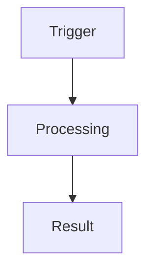

# Biz-A Planner

Produce an implementation-ready Biz-A plan grounded in the current repository. Create the plan only; do not implement code unless the user explicitly requests implementation too.

## Workflow

1. Read the task and identify the expected behavior, affected module type, and acceptance criteria.
2. Inspect repository instructions before source code:
   - `AGENTS.md`
   - `.github/copilot-instructions.md`
   - `.agents/rules/biz-a.rules.instructions.md` and relevant `.agents/references/*.md`
3. Locate the target module and its direct dependencies with `rg` or `rg --files`.
4. Read the relevant form, list, helper, library, schema, and nearby tests. Prefer an existing working module with the same behavior as the reference pattern.
5. Trace the current and intended flow. Resolve important unknowns from the repository; record only genuinely unresolved points as assumptions or questions.
6. Design the smallest coherent change that follows existing Biz-A lifecycle, library, query, naming, and validation patterns.
7. Write one Markdown file under `.agents/plans` using the required format below.
8. Re-read the plan and verify that every planned change maps to a listed file and every acceptance criterion maps to a verification step.

## Output Path

- Ensure `.agents/plans` exists.
- Name the file `YYYY-MM-DD-<short-kebab-topic>.md`.
- Use the current local date.
- If the path already exists, append `-2`, `-3`, and so on. Never overwrite an unrelated plan.
- Return the final plan path to the user.

## Required Plan Format

Use this structure. Omit a subsection only when it is demonstrably irrelevant.

````markdown
# <Task title>

## Objective
<Desired behavior and user-visible outcome.>

## Current State
<Relevant existing modules, flow, constraints, and concrete findings with paths.>

## Scope
- In scope: ...
- Out of scope: ...

## Proposed Flow


<Short explanation of the diagram and key design decisions.>

## Files
| Action | File | Planned change | Reason |
|---|---|---|---|
| Modify | `path/to/file.js` | ... | ... |
| Create | `path/to/new-file.js` | ... | ... |

## Implementation Steps
1. **<Step name>** (`path/to/file.js`)
   <Specific changes, functions/lifecycle hooks affected, data flow, and expected behavior.>

## Validation
- [ ] <Focused automated or manual check>
- [ ] <Regression check>

## Risks and Mitigations
| Risk | Mitigation |
|---|---|
| ... | ... |

## Assumptions / Open Questions
- ...
````

Keep the `Files` table explicit and exhaustive:

- Use only `Create`, `Modify`, or `Delete` in the Action column.
- Include repository-relative paths, not guessed filenames.
- State which functions, exports, fields, queries, or tests change.
- Include tests, fixtures, migrations, configuration, and documentation when affected.
- If no implementation file needs creation, say so after the table.

## Visualization Rules

- Include at least one Mermaid diagram inside the Markdown plan.
- Choose the diagram by the work being planned:
  - Use `flowchart` for lifecycle, data flow, and module relationships.
  - Use `sequenceDiagram` for save, API, event, or cross-module interactions.
  - Use `stateDiagram-v2` for status or approval transitions.
- Use simple node IDs and short ASCII labels.
- Show concrete Biz-A components such as form lifecycle hooks, list pipes, helpers, libraries, backend calls, and persisted data when relevant.
- Keep the diagram consistent with the implementation steps and file table.
- If repository Mermaid tooling is callable, validate and preview the diagram. Otherwise, manually check the diagram keyword, arrows, brackets, and identifiers and note that tooling was unavailable.

## Biz-A Planning Checks

- Identify whether each concern belongs in a form, list, helper, `lib_qry`, `lib_queryRaw`, `lib_utils`, or authorization library.
- Follow the repository's actual lifecycle and patterns; do not invent APIs from memory.
- Trace model, form value, payload, response, and detail-grid transformations where applicable.
- Identify lookup, `dbIndex`, listener, authorization, validation, and save-flow effects.
- Reuse existing helpers and libraries before proposing new ones.
- Call out database or backend contract assumptions explicitly.
- Prefer named implementation steps over vague instructions such as "update logic" or "adjust code".

## Planning Boundary

Do not modify source, configuration, database, or test files while producing the plan. The only filesystem changes allowed are creating `.agents/plans` and the requested plan Markdown file. If the user also asks for implementation, finish and present the plan first, then implement in a separate phase.
